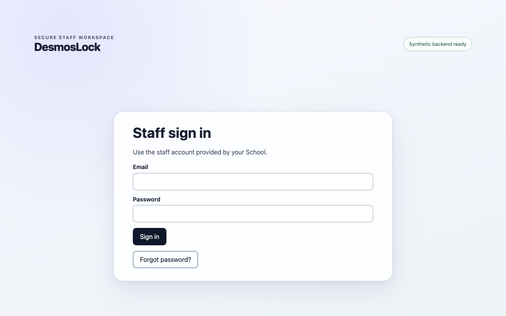

# DesmosLock

DesmosLock locks student Macs to a graphing calculator for the length of a
math test, and gives teachers a web app to run the test and manage each
student's session.

Project site: <https://desmoslock.nickymolina.com>



## Status

DesmosLock v2 is pre-release. There is no supported download, hosted service,
or release yet, and nothing in this repository should be used to run a real
test today.

- The v1 code is preserved at the [`v1.0.0`](https://github.com/danielholguin31/desmoslock/tree/v1.0.0)
  tag. It is no longer maintained and is being removed from `main`.
- The v2 desktop app does not embed the Desmos API yet. It currently uses a
  small graphing surface written in this repository that handles a fixed set
  of expressions, so the pipeline can be tested end to end without
  third-party assets.
- macOS lockdown depends on Apple's Automatic Assessment Configuration
  entitlement, which requires Apple approval and a signed build. Neither
  exists yet.

## How it works

A teacher signs in to the staff web app, opens a Test, and issues a join
code. Students open the desktop app and join with that code. They do not have
accounts. When a student starts the Test, the desktop app enters macOS
assessment mode, which blocks other apps until the session ends. Leaving early
means forfeiting the Test. The app keeps a durable local record so a crash or
restart resumes the same session, and it reports protection events to the
backend. The teacher sees each session in the staff app and can remove or
re-admit a student.

| Component        | Path           | What it is                                                                                                                                                     |
| ---------------- | -------------- | -------------------------------------------------------------------------------------------------------------------------------------------------------------- |
| Student desktop  | `apps/desktop` | Electron app for macOS. Hosts the calculator in an isolated view, joins Test sessions, and drives a native addon that uses Automatic Assessment Configuration. |
| Staff web        | `apps/web`     | Static TypeScript app for teachers and school admins: sign-in, invitations and recovery, School settings, staff memberships, Tests, and student sessions.      |
| Backend          | `supabase/`    | Postgres schema, row-level security and RPCs as versioned migrations, plus Deno Edge Functions for health, staff invitations, recovery, and student sessions.  |
| Shared libraries | `packages/`    | `domain` (business rules), `contracts` (typed wire formats shared by apps and functions), `test-support` (fixtures).                                           |

The desktop app holds no backend credentials. It calls the student-session
Edge Functions and signs its requests with an Ed25519 device key it generates
locally. The staff app signs in through Supabase Auth, and database rules
decide what each owner, administrator, or teacher can read or change.

## Develop

Use exactly Node.js 24.20.0 and npm 11.12.1 from the repository root.

```bash
npm ci
npm run format:check
npm run lint
npm run typecheck
npm test
DESMOSLOCK_PUBLIC_BACKEND_ENVIRONMENT=local \
DESMOSLOCK_PUBLIC_BACKEND_URL=http://127.0.0.1:54321 \
DESMOSLOCK_PUBLIC_WEB_ORIGIN=http://localhost:43174 \
DESMOSLOCK_PUBLIC_SUPABASE_PUBLISHABLE_KEY=sb_publishable_rrrrrrrrrrrrrrrrrrrrrr_cccccccc \
  npm run build
```

The build fails unless all four `DESMOSLOCK_PUBLIC_*` values are set. The key
above is a synthetic test value, not a real credential.

A local database needs Docker. It starts from `supabase/migrations/` and the
synthetic `supabase/seed.sql`:

```bash
npm run db:start
npm run db:reset
npm run test:db
npm run db:stop
```

The full verification lanes, including the staff-auth stack, Electron tests,
and backup round trip, are described in the
[maintainer guide](docs/maintainers.md).

## Repository layout

| Path        | Contents                                                            |
| ----------- | ------------------------------------------------------------------- |
| `apps/`     | Student desktop app and staff web app                               |
| `packages/` | Shared domain logic, wire contracts, and test fixtures              |
| `supabase/` | Migrations, seed data, Edge Functions, email templates, SQL tests   |
| `scripts/`  | Build, packaging, verification, and synthetic backup tooling        |
| `tests/`    | Repository contracts, acceptance tests, end-to-end and native tests |
| `docs/`     | Maintainer guide and design and evidence records                    |
| `site/`     | Static source for the project site                                  |

## More

- [Maintainer guide](docs/maintainers.md): source contract, verification
  lanes, and historical evidence rules
- [Contributing](CONTRIBUTING.md)
- [Security policy](SECURITY.md)
- [Code of conduct](CODE_OF_CONDUCT.md)
- [Changelog](CHANGELOG.md)

## Authors and license

DesmosLock is built by Nicky Molina ([@nicolasdmolina](https://github.com/nicolasdmolina))
and Daniel Holguin ([@danielholguin31](https://github.com/danielholguin31)).

It is licensed under the [GNU Affero General Public License v3.0](LICENSE).
DesmosLock is an independent project and is not affiliated with or endorsed by
Desmos Studio.
